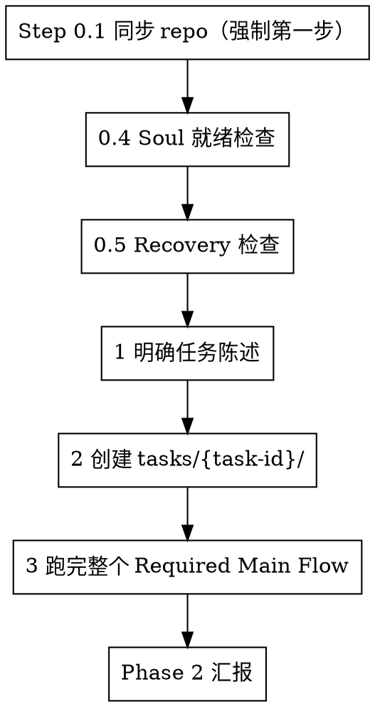

# MindFlow

用 MindFlow 把用户的意图当成一个 `Task` 跑完整流程：`Task -> Learning(Read) -> Recognition -> Analysis -> Planning -> Execution Control -> Reflection -> Learning`。

支持在任意目录下调度，自动在用户目录下维护一个共享的 MindFlow 工作区。

## 本 skill 的定位：薄封装，不做业务逻辑

本 skill **不定义** MindFlow 的任何规则。所有流程、产物、校验、门禁都以 clone 下来的仓库为准：

1. `SYSTEM.md` —— 唯一的权威协议（流程骨架 + 跨模块规则 + Recovery Protocol + Self-Check Points）
2. `CLAUDE.md` —— 运行时入口
3. `CONTRIBUTING.md` —— commit 规范与 `task-id` 格式
4. 各模块 `README.md` / `TEMPLATE.md` —— 进入该模块时才加载

当本 skill 的表述与仓库内容冲突时，**以仓库为准**，并提醒用户本 skill 已需要同步更新。不要凭本 skill 的记忆去写任何产物。

### Lazy Loading 是上游的核心原则，不得违反

- 任务开始时只加载 `SYSTEM.md`；进入某个模块时才读该模块的 `README.md`，产出某类产物时才读对应 `TEMPLATE.md`
- 进入**每个**模块都必须重新读一遍 `mind/soul/core.md`（Soul 约束不能从上一个阶段的记忆里沿用）
- 目录索引类 README（`mind/README.md`、`capabilities/README.md`、`sources/README.md`）是给人看的导航文件，运行时**不加载**
- 不要预读、预扫描、预总结模块内容；没进入的模块，其规则就不需要

## Phase 0: 环境准备

### Step 0.1: 定位并同步协议（强制第一步）

**`/mindflow` 被调用的第一个动作永远是这一步**，先于任何读取、提问、搜索、规划。

协议就在这个技能自己的目录里——`SYSTEM.md` 和本文件同级。所以没有路径要猜：

1. **协议根 = 技能所在目录**。`SYSTEM.md`、`CLAUDE.md`、`CONTRIBUTING.md`、各模块 `README.md` / `TEMPLATE.md`、`templates/` 全都在这里
2. **确定它的绝对路径**（技能可能是软链接，要解析到真实目录）：

   ```bash
   PROTOCOL_ROOT="$(cd "$(dirname "$(readlink -f "$0" 2>/dev/null || echo "$0")")" && pwd)"
   test -f "$PROTOCOL_ROOT/SYSTEM.md" || { echo "no SYSTEM.md beside the skill"; exit 1; }
   ```

3. **同步最新 `main`**：

   ```bash
   git -C "$PROTOCOL_ROOT" pull --ff-only origin main
   ```

   - 如果 `$PROTOCOL_ROOT` 不是一个 git 仓库（例如技能被单独拷贝出来）：跳过同步，继续用本地的协议，并在汇报里说明这次用的是未同步的副本
   - `--ff-only` 失败（本地有分叉提交、或未提交改动挡路）：**停下来向用户汇报**具体输出，不要 `reset --hard`、不要 `stash -u`、不要强推
4. **确认可用**：检查 `$PROTOCOL_ROOT/SYSTEM.md` 存在。不存在则**直接失败并报错**

因为运行态和协议已经分离（见 Step 0.2），同步理论上不该再因为「本地改动挡路」而失败。真失败了，说明有东西被写进了协议目录，要查清原因再处理。

### Step 0.2: 解析 Runtime Root（本 skill 的关键一步）

MindFlow 把树分成两棵，`$PROTOCOL_ROOT`（即本技能所在目录）只是其中之一：

| 树 | 内容 | 谁写 | 在 git 里 |
|----|------|------|-----------|
| **Protocol Root** | 本技能所在目录：`SYSTEM.md`、`CLAUDE.md`、`CONTRIBUTING.md`、各模块 `README.md` / `TEMPLATE.md`、`templates/` | 只有上游 | 是 |
| **Runtime Root** | `Soul`、知识库、审核记录、任务学习、knowledge gaps、capability updates、`capabilities/`、`tasks/`、`sources/` | 运行时和用户 | **否** |

**规则**：协议文档里凡是运行态路径（`mind/soul/core.md`、`mind/learning/knowledge-base/**`、`mind/learning/reviews/**`、`mind/learning/task-learning/**`、`mind/learning/knowledge-gaps/**`、`mind/learning/capability-updates/**`、`capabilities/**`、`tasks/**`、`sources/**`）都**相对 Runtime Root 解析**；协议文件路径仍相对 Protocol Root。相对路径和文件名一个字都没变，变的是解析到哪棵树。

按 `SYSTEM.md §Runtime Layout §Runtime Root Resolution Order` 解析，顺序是：

1. 环境变量 `MINDFLOW_RUNTIME_ROOT`（已设置且非空就用它）
2. `$PROTOCOL_ROOT/runtime/` —— 默认，**没有覆盖时用这个**
3. 调用方或用户显式指定的路径（比如「一个项目一个运行态」），只在本次任务生效

解析结果要记进 `tasks/{task-id}/state.md §Runtime Root`（绝对路径）。Recovery 以它为准，**不要**在已有任务已记录 Runtime Root 的情况下重新按默认值解析。

**初始化**：Runtime Root 不存在或不完整时，按 `SYSTEM.md §Runtime Layout §Initializing a Runtime Root` 从 `$PROTOCOL_ROOT/templates/` 复制骨架过去：

```bash
# 以默认位置为例
RUNTIME="$PROTOCOL_ROOT/runtime"
mkdir -p "$RUNTIME"
# 复制骨架，但去掉只为让 git 记录空目录的 .gitkeep
(cd "$PROTOCOL_ROOT/templates" && find . -type d -exec mkdir -p "$RUNTIME/{}" \; && find . -type f ! -name .gitkeep -exec cp {} "$RUNTIME/{}" \;)
```

- 覆盖路径（环境变量或用户指定）若不存在，**不要**擅自创建，报告后停下来问
- **绝不**把运行态产物写回 `templates/` 或 Protocol Root 的其它位置
- **绝不**在 `$PROTOCOL_ROOT` 里提交运行态

### Step 0.3: 读取运行时入口

读完 `SYSTEM.md`（权威协议，含 `§Runtime Layout`），并读一遍 `CLAUDE.md` 与 `CONTRIBUTING.md`（`task-id` 格式为 `YYYYMMDD-short-name`）。此时**不要**去读 `mind/` 下的模块 README。

当前调用者所在的目录**不是**工作目录。用户项目里的素材只有在任务确实需要时，才复制或引用进 `{runtime}/sources/`；不要把无关文件塞进 clone。

### Step 0.4: Soul 就绪检查

`{runtime}/mind/soul/core.md` 是**最高约束层**。它在 Runtime Root 里，所以是持续存在的状态：在这里填一次，之后所有任务都受它约束（如果这次用的是独立 Runtime Root，那就只对该运行态生效）。

仓库里只有种子模板 `templates/mind/soul/core.md`，不要改它。

检查 Runtime Root 的 `mind/soul/core.md` 的全部字段是否仍为 `To be defined`（Runtime Root 还没初始化的话，先按 Step 0.2 复制 `templates/`）：

- **不是**：直接进入 Step 0.5。
- **全部是**：按 `CLAUDE.md §First-Time Setup`，必须先把它填好才能做真实任务。
  - **必须和用户一起确认**八个字段（`Identity` / `Mission` / `Values` / `Taboos` / `Methodology Preference` / `Decision Style` / `Aesthetic Preference` / `Learning Policy`），可以用 `AskUserQuestion` 逐项或分组提问。
  - 参考 Protocol Root 的 `mind/soul/core-example.md` 的结构与粒度，但**不要照抄它的内容，也不要替用户编造价值观与禁忌**。用户没给的信息就留空或明确标注待补。
  - 写完后告知用户：这是跨项目、跨任务持续生效的约束层，想调整随时改这个文件。
  - 用户明确表示"先跳过"时，可以继续，但必须在 `learning-read.md §Soul Reads` 里如实记录（`mind/learning/learning-read/TEMPLATE.md` 的固定措辞：`Soul constraints not yet configured — no Soul constraints applied to this task`），并在最终汇报里再次提醒。

### Step 0.5: Recovery 检查

按 `SYSTEM.md §Recovery Protocol`，扫描 `{runtime}/tasks/` 下所有含 `state.md` 的任务。每个任务的 `state.md §Runtime Root` 记录了它当初用的运行态——**以它为准**，不要假设都等于当前解析出的 Runtime Root：

- 只看 `Current Phase`：不是 `completed` 也不是 `cancelled` 的，就是**未完成任务**
- 没有未完成任务：进入 Phase 1
- 有未完成任务：**必须续跑，不能重开**
  1. 读该任务 `state.md` 的 `Current Phase` / `Current Step`，向用户说明发现了什么、上次停在哪
  2. 读该阶段对应模块的 `README.md`（Protocol Root），并**重新读**该任务 Runtime Root 下的 `mind/soul/core.md`
  3. 从记录的阶段与 Step 继续（各阶段的续跑细则见 Recovery Protocol 第 5–11 条），不要从头再来
  4. 只有当用户明确要求"放弃这个任务"时，才另开新任务；旧任务目录不得复用，也不要把旧任务内容写回共享模板目录

### Step 0.6: 明确要做的任务

把用户这次调用 `/mindflow` 时给出的内容当作候选任务陈述：

- **有明确任务**（如"分析这个竞品"、"把我的 xx 项目重构方案写出来"）：直接采纳为任务陈述，进入 Phase 1
- **没有明确任务 / 只有方向**：先弄清要做什么再建任务，不要空转建目录。可以用 `WebSearch` 了解背景，整理 3–5 个候选任务，每个附"任务名称 + 为什么值得做 + 预期产物"，再用 `AskUserQuestion` 让用户选定或修正
- **如果任务需要用户项目里的素材**：问清路径，按需复制或引用进 `{runtime}/sources/`（规则见 Protocol Root 的 `sources/README.md`）

## Phase 1: 任务受理与初始化



### Step 1: 形成任务陈述

任务陈述要能写进 `task-profile.md` 的 `Goal`（2–5 句，说明这个任务要达成什么）。含糊就继续澄清，不要带着"大概是什么"的模糊描述进入流程——`Recognition` 的输入的清晰度决定了整条流程的质量。

### Step 2: 创建任务目录

按 `SYSTEM.md §Task Initialization` 执行：

1. 按 `CONTRIBUTING.md §Task ID Format` 确定 `task-id`（`YYYYMMDD-short-name`，例如 `20260324-refactor-learning`）
2. 创建 `{runtime}/tasks/{task-id}/`，含子目录 `_output/` 和 `cache/`
3. 进入 `Learning(Read)`：读 `mind/learning/learning-read/README.md`，创建 `state.md` 和 `learning-read.md`

`{runtime}/tasks/{task-id}/` 的固定结构见 Protocol Root 的 `tasks/TEMPLATE.md`，`state.md` 的固定结构见 `tasks/STATE-TEMPLATE.md`。**先建 `state.md`**，并把 Step 0.2 解析出的 Runtime Root 绝对路径写进 `§Runtime Root`，任务从第一刻起就是可恢复的。

## Phase 2: 驱动完整主流程

### 由当前会话直接驱动，不要外包

MindFlow 的 runtime 就是**当前这个 agent**：模块之间用文件交接（`state.md` + `cache/`），不是多 agent 编排。因此：

- **在当前会话里按模块顺序一路跑完**，不要像 pomasa-research 那样把整个流程打包成一个 Task 甩给子 agent——那样会丢失 Lazy Loading 的加载边界、丢失 `state.md` 的连续性，Recovery 也会失效
- **只在 MindFlow 明确要求"独立"的地方**用子 agent，且必须按 `SYSTEM.md §Subagent Soul Constraint` 构造 prompt：
  - `Learning(Acquire)` Stage 3 的 verification
  - terminal `Learning` step 4 的 `review-*.md`
  - 这些子 agent 的 prompt 里必须**逐字包含完整的 `{runtime}/mind/soul/core.md`**，并附上该子操作相关模块的 `README.md` / `TEMPLATE.md`；不要塞 `SYSTEM.md` 全文、不要塞无关历史上下文（minimum context principle）
  - 写 `draft-*.md` 的上下文不能同时写对应 `review-*.md`；`Verification Mode` 必须是 `independent-subagent`（退化规则见 `mind/learning/README.md §Subagent Unavailability`）
- `Plan` 里 `Dispatch Mode: subagent / parallel-branch` 的 Step 按 `mind/execution-control/README.md` 的调度规则来，同样受 Soul 注入约束

### 进入每个模块时

`SYSTEM.md §Required Main Flow` 规定的顺序**不得跳过、不得重排**：

| 模块 | 进模块先读 | 产物 |
|------|-----------|------|
| `Learning(Read)` | `mind/learning/learning-read/README.md` | `state.md`、`learning-read.md` |
| `Recognition` | `mind/recognition/README.md` | `task-profile.md` |
| `Analysis` | `mind/analysis/README.md` | `analysis.md`（compact 模式下为 `analysis-plan.md`） |
| `Planning` | `mind/planning/README.md` | `plan.md`（compact 模式下无此文件） |
| `Execution Control` | `mind/execution-control/README.md` | `cache/`、`_output/`、`state.md` 推进 |
| `Reflection` | `mind/reflection/README.md` | `reflection-report.md` |
| `Learning(Acquire)`（按需） | `mind/learning/acquire/README.md` | `acquire/search-log.md`、`raw-sources/`、`verification-report.md` |
| terminal `Learning` | `mind/learning/README.md` + `mind/learning/task-learning/README.md` | `tl-{task-id}.md`、`draft-*.md`、`review-*.md`、`kb-*.md`、gap / `cu-*.md` |

进入模块前**必须**读该模块 `README.md` 并重新读 `{runtime}/mind/soul/core.md`；要写某类产物时再读对应 `TEMPLATE.md`。下表中「进模块先读」的 `README.md` / `TEMPLATE.md` 在 Protocol Root，「产物」一列在 Runtime Root。`Required Reads` 是硬性输入，但不要去追它里面提到的二级引用。

### 关键门禁不得绕过

`SYSTEM.md §Self-Check Points` 列出的检查点，任何一个失败都要**停下来解决**，不许跳过、延后或变通：

1. 写 `plan.md` 之前 —— `mind/planning/README.md §Pre-Write Verification`
2. 执行 `Learning: acquire-required` 的 Step 之前 —— `mind/execution-control/README.md §Pre-Step Verification`
3. 写 `tl-{task-id}.md` 之前 —— `mind/learning/README.md §ACQ Label Reconciliation`
4. terminal `Learning` step 2 冻结之前 —— `mind/learning/README.md §Excerpt Fidelity Check`
5. 写 `kb-*.md` 之前 —— `mind/learning/README.md §Promotion Gate Check`
6. 标记任务 `completed` 之前 —— `mind/learning/README.md §Task Completion Check`

每完成一个阶段都要按 `SYSTEM.md §Phase Transition Protocol` 更新 `state.md`。状态没更新 = 任务不可恢复。

### terminal Learning 是必跑项，不是可选项

即使本次任务"看起来没有可学的"，也必须完整跑完 terminal `Learning`：

1. 写 `mind/learning/task-learning/tl-{task-id}.md`（没有学习候选就写 `Candidate Knowledge: none`、`Next Promotion Target: none`，但文件必须存在）
2. step 2 自检后 `tl-{task-id}.md` 冻结
3. 有候选时按固定晋升路径 `task-learning/` → `drafts/` → `reviews/` → `knowledge-base/approved/` 推进（只有 approved 才能被后续任务复用）；被拒绝的草稿移到 `archived/`，deferred 的留在 `drafts/` 等后续复审
4. 处理 knowledge gaps（`resolved` / `Retry Count` / `permanent`）
5. 处理 capability updates（`cu-{task-id}-{capability-name}.md`，新建的一律 `Status: proposed`，同任务内不得升到 `approved`）
6. 计算 `Knowledge Outcome`（`fully-acquired / partially-acquired / not-acquired / not-applicable`），通过 `Exit Validation` 后才设置最终状态

### 不要在中间提前收工

这条流程的典型失败模式是：agent 做到 `Planning` 或做完第一个 Step 就宣布"任务完成"。以下任何一条未满足，都不算完成：

- `state.md` 的 `Current Phase` 在 `completed` 或 `cancelled`
- `_output/` 非空（`Overall Status: completed` 时；`blocked / failed / cancelled` 有豁免规则，见 `mind/learning/README.md §Task Completion Check`）
- 端到端产物都在：`learning-read.md`、`task-profile.md`、`analysis.md` 或 `analysis-plan.md`、`plan.md` 或 compact 声明、`reflection-report.md`、`mind/learning/task-learning/tl-{task-id}.md`，以及（若有）`acquire/`、`draft-*.md`、`review-*.md`、`kb-*.md`、`knowledge-gaps/gap-*.md`、`capability-updates/cu-*.md`
- `Step Status Map` 里没有残留 `pending`（`blocked / failed` 场景按豁免规则处理）
- `reflection-report.md` 的 `Requires External Acquisition` 若为 `yes`，对应 ACQ 已跑完且已进入 `tl-{task-id}.md §External Acquisition`

### 工作区纪律

- **不要在 `$PROTOCOL_ROOT` 里创建 commit**，除非用户明确要求。这是 AGPL-3.0 的上游仓库，且带 lefthook + commitlint 钩子
- 若用户确实要求提交，先按 `CONTRIBUTING.md` 执行（conventional commits、必填 scope 与 body、不得出现 `Co-Authored-By` / `Signed-off-by` 等行、`task-id` 格式），并尊重 `lefthook.yml` 与 `commitlint.config.js`
- **运行态一律写 Runtime Root**；不要往 Protocol Root（`$PROTOCOL_ROOT`）写任何运行态产物，也不要改 `SYSTEM.md`、`CLAUDE.md`、`CONTRIBUTING.md`、`mind/` 下的协议文件或 `templates/`
- 产物默认落在 `{runtime}/tasks/{task-id}/_output/`；只有 `Plan` 显式声明了 publish-back 路径时，才把结果发布到 `{runtime}/sources/`
- `{runtime}/capabilities/cap-{name}.md` 不存在是正常状态（bootstrap 阶段），此时 `Capability` 标签只作分类标识，跳过约束加载，**不要**为了"跑通"临时编一个能力文件

## Phase 3: 结果汇报

流程跑完后，向用户汇报（内容都从实际文件里读，不要凭印象写）：

1. **交付物**：`_output/` 下产物的完整路径，以及各自一句话说明
2. **最终状态**：`state.md` 的 `Current Phase` / `Overall Status` / `Knowledge Outcome`
3. **Reflection**：`reflection-report.md` 的结论要点（成功标准达成情况、问题与教训、`Capability Impact`）
4. **学到了什么**：`tl-{task-id}.md` 的候选知识；晋升结果（`draft-*.md` / `review-*.md` / 进入 `approved/` 的 `kb-*.md`，或 rejected / deferred）；新增或变化的 knowledge gaps、capability updates
5. **下一步**：未解决的 gap、待复审的 deferred review、`Status: proposed` 的 capability update 分别要怎么推进

需要打开任务目录时（可选，先问过用户）：

- **macOS**: `open {runtime}/tasks/{task-id}/`
- **Windows**: `explorer {runtime}\tasks\{task-id}\`
- **Linux**: `xdg-open {runtime}/tasks/{task-id}/`

## 关键文件

路径分两棵树，务必分清：

- **Protocol Root** = `$PROTOCOL_ROOT`，就是本技能所在目录（只读协议，git 管）
- **Runtime Root** = `{runtime}`（用户状态，git 不管；默认 `$PROTOCOL_ROOT/runtime/`）

| 文件 | 用途 |
|------|------|
| `SYSTEM.md` | 权威协议：流程骨架、**§Runtime Layout**、Recovery Protocol、Self-Check Points |
| `CLAUDE.md` | 运行时入口（`AGENTS.md` / `CODEX.md` / `GEMINI.md` 等均为其 symlink） |
| `CONTRIBUTING.md` | commit 规范、`task-id` 格式 `YYYYMMDD-short-name` |
| `templates/mind/soul/core.md` | Soul 种子模板（Protocol Root）；初始化 Runtime Root 时复制过去 |
| `{runtime}/mind/soul/core.md` | **最高约束层**（Runtime Root）；每个模块入口都要重读 |
| `mind/soul/core-example.md` | Soul 填写参考（运行时**不加载**，仅作示例） |
| `mind/learning/learning-read/README.md` | `Learning(Read)` 规则与读范围 |
| `mind/recognition/README.md` | `Recognition` 规则，产出 `task-profile.md` |
| `mind/analysis/README.md` | `Analysis` 规则、compact mode、`Inference` 触发 |
| `mind/planning/README.md` | `Planning` 规则，产出 `plan.md` |
| `mind/execution-control/README.md` | Step 推进、调度、失败策略、转入 `Reflection` |
| `mind/reflection/README.md` | `Reflection` 规则，产出 `reflection-report.md` |
| `mind/learning/README.md` | terminal `Learning` 七步、晋升路径、各项自检 |
| `mind/learning/acquire/README.md` | `Learning(Acquire)` 三阶段（含 Stage 3 独立校验） |
| `{runtime}/mind/learning/knowledge-base/` | `approved/`（唯一正式知识区）、`drafts/`、`archived/` |
| `{runtime}/mind/learning/reviews/` | `review-{task-id}-{slug}.md`，独立子 agent 产出 |
| `{runtime}/mind/learning/knowledge-gaps/` | `gap-{task-id}-{slug}.md`，ACQ exhausted 的产物 |
| `{runtime}/mind/learning/capability-updates/` | `cu-{task-id}-{capability-name}.md` |
| `mind/inference/README.md` | 条件模块：`Analysis` / `Reflection` / terminal `Learning` 中按需触发 |
| `tasks/TEMPLATE.md` | `tasks/{task-id}/` 固定结构与约束（Protocol Root 的模板） |
| `tasks/STATE-TEMPLATE.md` | `state.md` 固定结构与校验规则，含 `§Runtime Root` 字段 |
| `sources/README.md` | 项目级素材与 publish-back 规则 |
| `capabilities/TEMPLATE.md` | `cap-{name}.md` 的编写规则（bootstrap 期可不创建） |
| `{runtime}/capabilities/`、`{runtime}/tasks/`、`{runtime}/sources/` | 运行态的其余三处根目录 |

## 交付前自检

宣布完成之前，逐条对照：

- [ ] Step 0.1 确实执行过：`git clone` 或 `git pull --ff-only origin main`，且 `SYSTEM.md` 存在
- [ ] Step 0.2 解析出的 Runtime Root 已记录在 `state.md §Runtime Root`（绝对路径），必要时已从 `templates/` 初始化
- [ ] Soul 已就绪，或已明确告知用户"未配置"并记录在 `learning-read.md`
- [ ] Recovery 检查做过；不存在"应该续跑却新开任务"的情况
- [ ] 主流程八个阶段一个没少，顺序没变
- [ ] 每个模块都是进入时才加载的（没有预读、没有跳过 Soul 重读）
- [ ] 该用独立子 agent 的地方用了，且 prompt 里逐字带上了 `mind/soul/core.md`
- [ ] 六项 Self-Check 全部通过或已被解决
- [ ] terminal `Learning` 跑完，含 `tl-{task-id}.md` 与 gap / capability update 处理
- [ ] `state.md` 到终态，`_output/` 非空，`Step Status Map` 无残留 `pending`
- [ ] 所有运行态产物都在 Runtime Root 内，Protocol Root 与 `templates/` 保持干净
- [ ] 没有在 MindFlow 仓库里制造 commit
